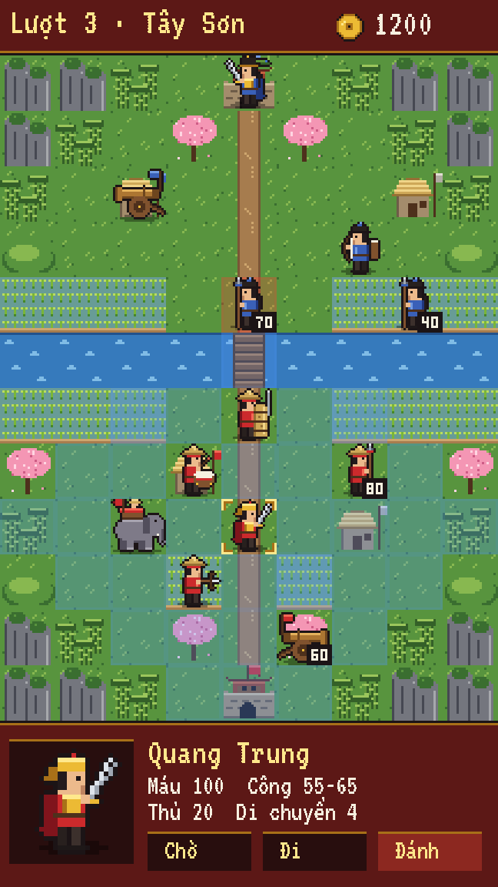
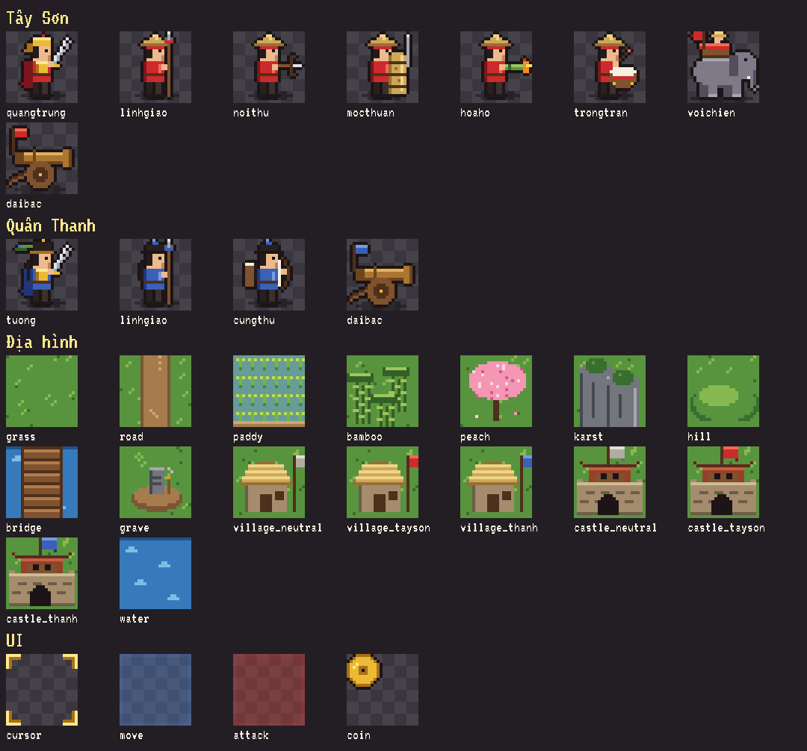

# Quang Trung (tên tạm) — bản nháp thiết kế

> **Trạng thái: nháp / thử phong cách.** Chưa có project GameMaker. Asset ở đây chỉ dùng để
> chốt hướng hình ảnh và bàn nội dung; các con số trong bảng chỉ là gợi ý ban đầu.

Game chiến thuật theo lượt trên lưới ô vuông, lối chơi gần như **Ancient Empires 2**, chạy trên
điện thoại (màn hình dọc). Lấy cảm hứng từ chiến dịch Quang Trung đại phá quân Thanh (Tết Kỷ Dậu 1789),
không bám sát lịch sử.





## Tạo lại asset

```bash
pip install pillow
python generate_assets.py     # tạo lại assets/, preview_sheet.png và mockup_phone.png
```

- Ô lưới **24x24** (bằng AE2), lính 24x24, 2 frame đứng thở, vẽ **nhìn sang phải**; phe địch lật ngang.
- Màu phe chỉ nằm ở 3 màu `team_dark / team / team_light` trong `TEAMS`, nên thêm phe hay đổi màu rất nhanh.
- Mockup: màn hình gốc 216x384 (9 cột × 12 hàng ô + thanh trên + bảng thông tin), phóng ×3 = 648x1152.
  Ô xanh là các ô đi được (4 bước), ô đỏ là lính địch đánh được.
- Font VT323 (OFL, có tiếng Việt) nằm trong `fonts/`.

## Đối chiếu lối chơi AE2 với game này

| AE2 | Bản này | Vai trò / cơ chế |
|---|---|---|
| King (Galamar) | **Quang Trung** (chủ tướng) | Chiếm thành, mua lính ở thành; chết thì mua lại được (đắt dần) |
| Soldier | **Lính giáo** | Rẻ, chiếm làng |
| Archer | **Nỏ thủ** | Đánh xa 2 ô |
| Golem | **Mộc thuẫn** | Khiên bện rơm tẩm nước (trận Ngọc Hồi): thủ rất cao, chặn đường |
| Spider (độc) | **Hỏa hổ** | Ống tre phun lửa: gây "cháy", mất máu mỗi lượt |
| Wisp (hào quang) | **Trống trận** | +công cho quân đứng cạnh |
| Catapult | **Đại bác** | Bắn xa 2–4 ô, không bắn ô sát bên, phải đứng yên mới bắn |
| Wyvern | **Voi chiến** | Mạnh, đắt; xô lùi địch? |
| Lizard (nước) | **Thủy binh**? | Đi nhanh trên sông (chưa vẽ) |
| Wizard (gọi xương) | **Thầy pháp / âm binh**? | Gọi lính từ mộ — có giữ yếu tố tâm linh không? (chưa vẽ) |
| Town / Castle | **Làng** (nhà tranh) / **Thành, đồn** | Làng cho vàng mỗi lượt và hồi máu; mua lính ở thành |
| Tombstone | **Mộ** | Lính chết để lại mộ |

Địa hình đã vẽ: cỏ, đường đất, ruộng lúa (đi chậm), rừng tre (+thủ), cây đào Tết, núi đá vôi (chặn),
đồi, sông, cầu, làng, thành, mộ.

## Phác thảo chiến dịch (gợi ý)

1. Phú Xuân — lên ngôi, xuất quân (màn hướng dẫn)
2. Nghệ An — tuyển quân dọc đường (chiếm làng để có thêm lính)
3. Tam Điệp — hội quân, phòng thủ
4. Sông Gián / Thanh Quyết — vượt sông
5. Hà Hồi — vây đồn trong đêm 30 Tết (màn đêm, tầm nhìn hẹp)
6. Ngọc Hồi — mộc thuẫn + voi chiến phá đồn chính
7. Khương Thượng (Đống Đa) — đánh úp từ hướng tây
8. Thăng Long — vào thành mùng 5 Tết

## Cần bàn trước khi làm thật

1. **Lịch sử hay giả tưởng?** Dùng tên thật (Quang Trung, Tôn Sĩ Nghị, quân Thanh) hay đổi tên / phe giả tưởng?
   Điều này ảnh hưởng tới việc phát hành ngoài Việt Nam.
2. **Mức độ bám AE2:** giữ nguyên bộ quy tắc (thăng cấp, mua lính, chiếm làng, mộ, thầy pháp) hay rút gọn?
   Có thêm gì mới (tướng có kỹ năng riêng, thời tiết, đêm / ngày)?
3. **Chế độ chơi:** chỉ chiến dịch, hay thêm đánh tự do (skirmish) và chơi 2 người chung máy như AE2?
4. **Màn hình dọc hay ngang?** Mockup đang là dọc 9:16 (chơi một tay, giống AE2 trên điện thoại cũ).
5. **Phong cách hình:** pixel art 24px như hiện tại, hay chi tiết hơn (32px, có chân dung nhân vật khi hội thoại)?
6. **Kiếm tiền / phạm vi:** miễn phí hoàn toàn, mua một lần, hay có quảng cáo? Bao nhiêu màn cho bản đầu?
