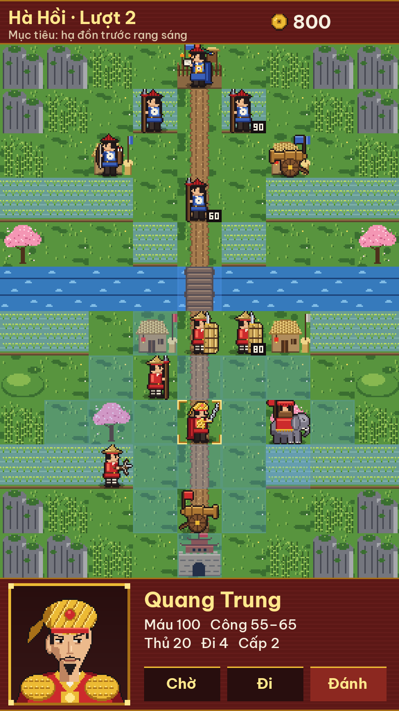
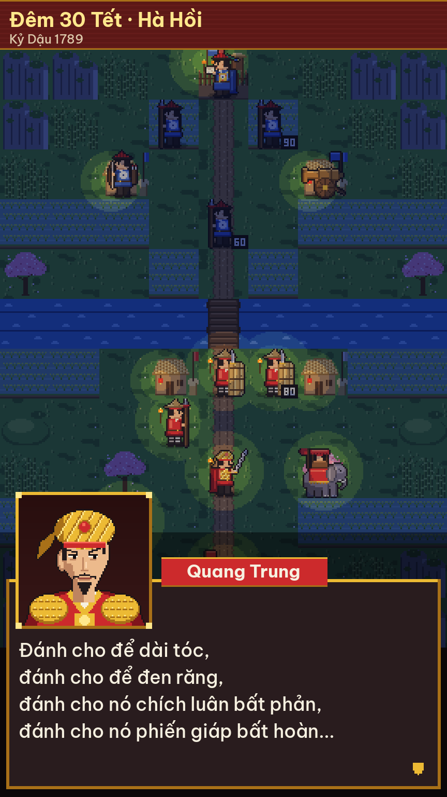
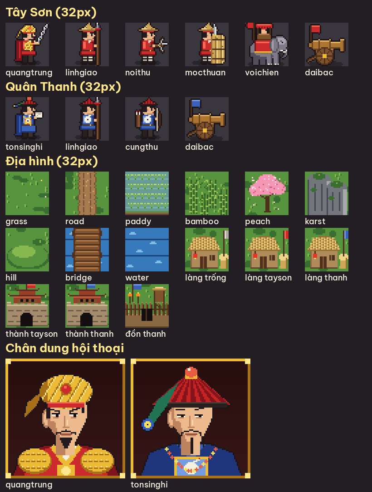

# Quang Trung (tên tạm) — bản nháp thiết kế

> **Trạng thái: nháp / thử phong cách.** Chưa chọn xong engine, chưa có project. Asset ở đây dùng để
> chốt hướng hình ảnh và bàn nội dung. Thiết kế chi tiết (chỉ số lính, màn chơi) sẽ chốt **sau khi
> nghiên cứu tài liệu lịch sử**.

Game chiến thuật theo lượt trên lưới ô vuông, **bám sát lối chơi Ancient Empires 2**, phát hành trên
store di động. Dựa trên chiến dịch Quang Trung đại phá quân Thanh (Tết Kỷ Dậu 1789).

## Đã chốt

| Vấn đề | Quyết định |
|---|---|
| Tên nhân vật, phe | Dùng tên thật: Quang Trung, Tôn Sĩ Nghị, quân Thanh... |
| Lối chơi | Bám sát AE2 (mua lính ở thành, chiếm làng, thăng cấp, mộ, 10 vai trò lính) |
| Màn bắt buộc | Đánh đêm 30 Tết (Hà Hồi) |
| Chế độ chơi | Trước mắt chỉ có chiến dịch |
| Màn hình | Dọc |
| Hình ảnh | Bản chi tiết (`assets_v2/`): ô 32px, có chân dung khi hội thoại |
| Engine | Không dùng GameMaker (bản miễn phí không được bán thương mại). Đề xuất **Godot 4** — xem dưới |
| Kiếm tiền, phạm vi bản đầu | Chưa chốt |

## Bản chi tiết (v2)






```bash
pip install pillow numpy
python generate_v2.py         # -> assets_v2/
```

- Ô lưới và lính **32x32**, 2 frame đứng thở, vẽ nhìn sang phải (phe địch lật ngang).
- Chân dung hội thoại **80x80** (Quang Trung, Tôn Sĩ Nghị), đặt trong khung 88x88 kiểu sơn mài viền vàng.
- Màn hình gốc **288x512** (9 cột × 12 hàng ô + thanh trên + bảng dưới); mockup phóng ×3 = 864x1536.
  Máy 1080x1920 thì phóng ×3,75 — cách xử lý tỉ lệ (phóng số nguyên + viền, hay phóng lẻ) để lúc dựng project.
- **Màn đêm** là một bộ lọc chung (`night()`): tối toàn bản đồ, sáng ấm quanh đuốc, đèn lồng Tết, đuốc
  trên tay lính Tây Sơn. Dùng được cho mọi bản đồ, không phải vẽ lại tile đêm. Trong game có thể kết hợp
  với "sương mù chiến tranh": chỉ thấy địch trong vùng sáng.
- Địa hình mới: **đồn** (lũy đất, hàng rào cọc, chòi canh, đuốc) cho các trận Hà Hồi, Ngọc Hồi.
- Font giao diện: Be Vietnam Pro (OFL, thiết kế cho tiếng Việt), trong `fonts/`.
- Tôn Sĩ Nghị đứng ở đồn Hà Hồi chỉ để minh họa; thực tế lúc đó ông ở Thăng Long.
- Câu thoại trong mockup ("Đánh cho để dài tóc...") được ghi lại trong *Hoàng Lê nhất thống chí*.
  Cần đối chiếu nguồn khi viết kịch bản.

Bản đầu (`generate_assets.py` → `assets/`, ô 24px) vẫn giữ lại để so sánh.

## Engine đề xuất: Godot 4

| | Godot 4 | Defold | Unity Personal |
|---|---|---|---|
| Giá | Miễn phí, giấy phép MIT | Miễn phí | Miễn phí khi doanh thu + vốn < 200.000 USD/năm |
| Phí bản quyền / chia doanh thu | Không | Không | Không, nhưng vượt ngưỡng thì phải mua Pro |
| Android / iOS | Có (iOS cần máy Mac + Xcode) | Có | Có |
| Hợp game 2D theo lượt | Rất hợp: TileMap, UI, tween, dịch thuật có sẵn | Hợp, file build nhỏ | Hợp nhưng nặng cho game 2D nhỏ |
| Ngôn ngữ | GDScript (giống Python), C# | Lua | C# |

Chọn **Godot 4** vì miễn phí trọn đời, không ràng buộc doanh thu, có trình biên tập TileMap và UI mạnh,
GDScript dễ học. Hệ thống dịch thuật có sẵn để sau này thêm tiếng Anh. Asset hiện tại là PNG thường,
đưa thẳng vào Godot được; script Python vẫn dùng tiếp để sinh asset.

## Đối chiếu lối chơi AE2

Vai trò lấy theo AE2; **lính Việt / Thanh tương ứng chỉ là gợi ý**, chờ nghiên cứu lịch sử để chốt.

| AE2 | Gợi ý | Vai trò / cơ chế |
|---|---|---|
| King (Galamar) | **Quang Trung** (chủ tướng) | Chiếm thành, mua lính ở thành; chết thì mua lại được (đắt dần) |
| Soldier | **Lính giáo** | Rẻ, chiếm làng |
| Archer | **Nỏ thủ** | Đánh xa 2 ô |
| Golem | **Mộc thuẫn** | Khiên bện rơm tẩm nước (trận Ngọc Hồi): thủ rất cao |
| Spider (độc) | **Hỏa hổ** | Gây "cháy": mất máu mỗi lượt |
| Wisp (hào quang) | **Trống trận** | +công cho quân đứng cạnh |
| Catapult | **Đại bác** | Bắn xa, không bắn ô sát bên, phải đứng yên mới bắn |
| Wyvern | **Voi chiến** | Mạnh, đắt |
| Lizard (nước) | **Thủy binh**? | Đi nhanh trên sông |
| Wizard (gọi xương) | ? | Gọi lính từ mộ — cần tìm vai trò hợp lịch sử |
| Town / Castle | **Làng** / **Thành, đồn** | Làng cho vàng mỗi lượt và hồi máu; mua lính ở thành |
| Tombstone | **Mộ** | Lính chết để lại mộ |

## Phác thảo chiến dịch (chờ nghiên cứu)

1. Phú Xuân — lên ngôi, xuất quân (màn hướng dẫn)
2. Nghệ An — tuyển quân dọc đường
3. Tam Điệp — hội quân
4. Sông Gián / Thanh Quyết — vượt sông
5. **Hà Hồi — đêm 30 Tết** (màn đêm)
6. Ngọc Hồi — mộc thuẫn + voi chiến phá đồn
7. Khương Thượng (Đống Đa) — đánh từ hướng tây
8. Thăng Long — vào thành mùng 5 Tết

## Việc tiếp theo

1. Nghiên cứu tài liệu lịch sử: diễn biến, mốc thời gian, nhân vật, binh chủng và vũ khí của hai bên,
   trang phục; ghi rõ nguồn và chỗ các nguồn nói khác nhau.
2. Chốt danh sách lính (10 vai trò AE2) và danh sách màn dựa trên nghiên cứu.
3. Viết tài liệu thiết kế chi tiết: chỉ số, bảng khắc chế, chi phí địa hình, thăng cấp.
4. Dựng project Godot 4, làm thử một màn (Hà Hồi đêm 30 Tết).
5. Chốt cách kiếm tiền và phạm vi bản đầu.
