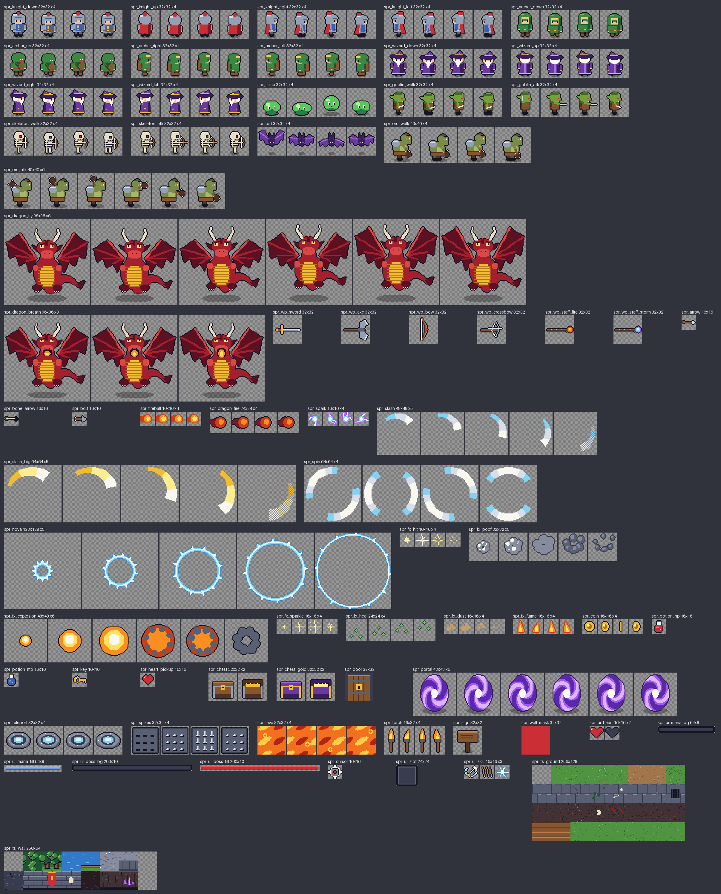

# Truyền Thuyết Diệt Rồng

Game hành động nhập vai nhìn từ trên xuống, làm bằng GameMaker LTS 2026.
Chọn một trong ba anh hùng, vượt qua khu rừng, hầm ngục và hang lửa để đánh bại **Hỏa Long**.



## Chạy game

Mở `DietRong/DietRong.yyp` bằng GameMaker rồi nhấn **F5**.

| Phím | Tác dụng |
|---|---|
| WASD / phím mũi tên | Di chuyển |
| Chuột | Ngắm (nhân vật và vũ khí quay theo chuột) |
| Chuột trái (giữ) | Đánh thường |
| Chuột phải / E | Chiêu đặc biệt (tốn năng lượng xanh) |
| SPACE | Lướt — bất tử trong lúc lướt, né được đạn và dung nham |
| Q / lăn chuột / 1, 2 | Đổi vũ khí |
| R | Chơi lại màn khi thua |
| ESC | Về menu |

## Nội dung

**Anh hùng** (chọn ở menu)

| | Máu | Vũ khí ban đầu | Vũ khí trong rương tím | Chiêu đặc biệt |
|---|---|---|---|---|
| Hiệp sĩ | 6 | Kiếm thép (chém quạt, chém được cả tên bắn tới) | Rìu chiến | Lốc xoáy kiếm: chém quanh mình, bất tử khi xoay |
| Cung thủ | 5 | Cung gỗ | Nỏ ba tên | Mưa tên: 9 mũi xuyên thấu |
| Phù thủy | 4 | Gậy lửa (cầu lửa nổ lan) | Gậy sét (tia xuyên thấu) | Vòng băng: đóng băng quái xung quanh |

**Quái**: slime, yêu tinh (đâm dao), xương cung thủ (giữ khoảng cách, bắn tên), dơi (bay qua chướng ngại),
orc (đập chùy, có vòng đỏ báo trước), và trùm **Hỏa Long** (phun lửa, vòng cầu lửa, gọi dơi; dưới nửa máu thì đánh nhanh hơn).

**Màn chơi**

| Màn | Nội dung | Ảnh |
|---|---|---|
| 1. Rừng Sương Mù | Biển hướng dẫn, rương vũ khí, tìm chìa khóa mở cổng đá | [xem](maps/preview_level1.png) |
| 2. Hầm Ngục Xương | Bẫy chông, 2 cửa khóa, orc giữ chìa, bàn dịch chuyển tới phòng bí mật | [xem](maps/preview_level2.png) |
| 3. Hang Hỏa Long | Dung nham, đấu trùm, cổng về nhà hiện ra khi rồng chết | [xem](maps/preview_level3.png) |

Vật phẩm: vàng, bình máu, bình năng lượng, chìa khóa, trái tim (+1 máu tối đa). Thua thì chơi lại từ đầu màn;
thắng thì lưu kỷ lục thời gian cho từng nhân vật (`save.ini`).

## Liên hệ với bài học material_8

Game giữ nguyên các kỹ thuật của project mẫu `references/material_8`, chỉ mở rộng thêm:

| material_8 | Trong game này |
|---|---|
| `player_process`: `player_input`, `player_move`, `player_ani` (4 hướng theo chuột), camera | `scr_player` — thêm lướt, kỹ năng, đổi vũ khí, camera rung |
| `WeaponInit` + `global.weapon_list`, vũ khí xoay theo chuột | `WeaponInit` trong `scr_config` có thêm cận chiến / xuyên thấu / nổ lan |
| `obj_enemy` cha + `enum ESTATE`, `mp_grid_path` đuổi người chơi | `obj_enemy` cha + 5 loại quái con, `event_user(0)` cho đòn đánh riêng |
| `obj_controller` đổi tile tường thành `obj_wall` + tạo `mp_grid` | `obj_level` + `level_build_walls()` |
| Rương cho vũ khí, `obj_fake_item` bay lên | `obj_chest`, `obj_chest_gold`, `obj_fake_item` |
| `obj_gate` qua room, `obj_gate1/2` dịch chuyển | `obj_portal`, `obj_teleport` |

So với material_8 (18 object, 3 script, 3 room, 28 sprite, ~520 dòng GML), game này có 36 object, 6 script,
5 room, 70 sprite và ~1550 dòng GML (nhiều dòng là chú thích tiếng Việt).

## Cấu trúc thư mục

```
games/diet-rong/
├─ generate_assets.py     # vẽ toàn bộ hình bằng Pillow -> assets/
├─ build_project.py       # dựng file .yy, room, tileset từ assets/ và maps/
├─ check_gml.py           # kiểm tra tĩnh code GML (ngoặc, tên tài nguyên, hàm, enum)
├─ assets/                # dải ảnh tên_stripN.png, sprites.json, preview_sheet.png
├─ maps/                  # bản đồ ASCII từng màn + ảnh xem trước (xem maps/README.md)
├─ template/              # options và font VT323 dùng chung
└─ DietRong/              # project GameMaker
   ├─ scripts/            # scr_config (số liệu), scr_player, scr_enemy, scr_combat, scr_level, scr_ui
   └─ objects/            # code GML của từng object (viết tay)
```

## Sửa game

- **Chỉ số nhân vật, vũ khí, chiêu**: `DietRong/scripts/scr_config/scr_config.gml`.
- **Chỉ số quái**: sự kiện Create của `obj_slime`, `obj_goblin`, `obj_skeleton`, `obj_bat`, `obj_orc`, `obj_dragon`.
- **Bản đồ**: sửa `maps/levelN.txt` (bảng ký tự trong `maps/README.md`) rồi chạy `python build_project.py`.
- **Hình ảnh**: sửa `generate_assets.py` (bảng màu `PALETTE` ở đầu file), chạy `python generate_assets.py`
  rồi `python build_project.py`.
- Sau khi sửa code nên chạy `python check_gml.py`.

`build_project.py` ghi đè các file `.yy` và room (code `.gml` thì không bị đụng tới). Nếu sửa room hoặc
thêm object ngay trong GameMaker thì đừng chạy lại script, hoặc chuyển thay đổi đó vào `maps/*.txt`
và bảng `OBJECTS` trong `build_project.py`.

## Ghi chú

- Font VT323 (SIL Open Font License) nằm trong Included Files, đủ dấu tiếng Việt.
- Chưa có âm thanh.
